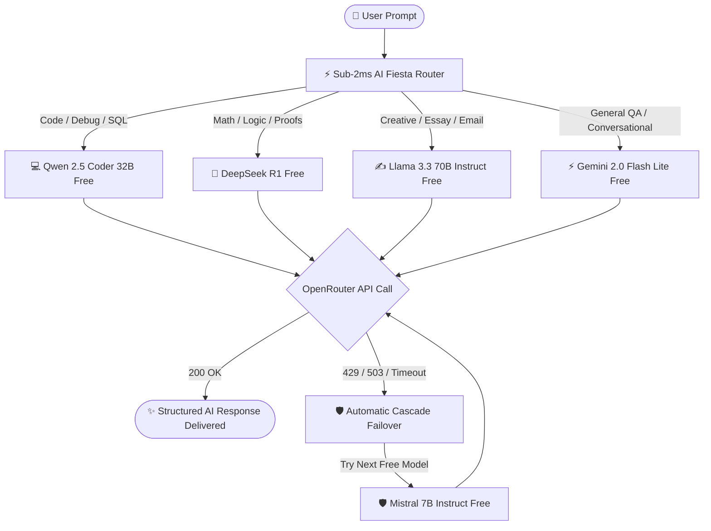

# 🚀 arkAI — Pure OpenRouter Orchestration Platform
**ARK Ecosystem Serverless AI Infrastructure | CodeAlpha_AIChatbot**

[](https://vercel.com)
[](https://openrouter.ai)
[](#sub-2ms-heuristic-classifier)
[](LICENSE)

---

## 📖 Overview

**arkAI** is a high-speed, serverless AI orchestration platform engineered for the **ARK Ecosystem**, deployed on **Vercel Serverless Functions**. It is built on a **Pure OpenRouter Architecture**: all model calls route exclusively through the OpenRouter API without fragmented vendor SDKs.

Incoming prompts are processed by the **"AI Fiesta Engine"** — an in-memory heuristic router executing in **< 2ms** to automatically assign the optimal free model based on query intent. If a free model encounters rate limits (`429`), temporary upstream spikes (`503`), or timeouts, arkAI's **Automatic Cascade Failover** seamlessly retries the next model in the free pool without dropping the user's conversation.

---

## 🏗️ Architecture & Mermaid Workflow Diagrams

### 1. Heuristic Routing & Execution Pipeline



### 2. Automatic Cascade Failover Sequence

```mermaid
sequenceDiagram
    autonumber
    actor User as 👤 User
    participant Frontend as 🖥️ arkAI Glassmorphic UI
    participant Router as ⚡ AI Fiesta Router (<2ms)
    participant OR as 🌐 OpenRouter API
    
    User->>Frontend: Enters query ("Refactor this React hook")
    Frontend->>Router: POST /api/chat
    Router->>Router: Heuristic Classification (<1.2ms) -> Selects Qwen 2.5 Coder Free
    Router->>OR: POST /v1/chat/completions (qwen/qwen-2.5-coder-32b-instruct:free)
    
    alt Model Available (200 OK)
        OR-->>Router: Completion payload
        Router-->>Frontend: Response + Metadata (model_used, routing_time_ms)
        Frontend-->>User: Displays syntax-highlighted code + [🔀 Try Next Model] button
    else Model Busy (429 Rate Limit / 503 Overloaded)
        OR-->>Router: HTTP 429 / 503
        Note over Router: Catches error immediately; Cascades to next in pool
        Router->>OR: POST /v1/chat/completions (deepseek/deepseek-r1:free)
        OR-->>Router: HTTP 200 OK
        Router-->>Frontend: Response + Failover history (Failover count: 1)
        Frontend-->>User: Displays response with Failover badge
    end
```

---

## 🎯 Free Model Pool Specification

All requests use high-performance **FREE** models (`:free` suffix) on OpenRouter:

| Priority | Model ID | Primary Domain | Badge |
| :---: | :--- | :--- | :--- |
| **1** | `google/gemini-2.0-flash-lite-001:free` | General Conversational QA & Maximum Speed | `⚡ Ultra-Fast` |
| **2** | `meta-llama/llama-3.3-70b-instruct:free` | Creative Writing, Content, Analysis | `✍️ Creative` |
| **3** | `deepseek/deepseek-r1:free` | Complex Logic, Mathematics & Deep Reasoning | `🧠 Deep Reasoning` |
| **4** | `qwen/qwen-2.5-coder-32b-instruct:free` | Code Generation, Debugging & Architecture | `💻 Software Engineering` |
| **5** | `mistralai/mistral-7b-instruct:free` | Lightweight Fallback Shield & Redundancy | `🛡️ Failover Shield` |

---

## 🔒 Security & Environment Variables

arkAI adheres to strict enterprise security standards:
1. **Zero Hardcoded Secrets**: Secrets are read exclusively via `os.getenv("OPENROUTER_API_KEY")`.
2. **Graceful Demo Mode**: If `OPENROUTER_API_KEY` is omitted, the platform does not crash. It returns a structured `demo_mode` diagnostic payload with instructions to set the key.
3. **Client-Side Key Override**: Users can optionally supply their personal OpenRouter key in the UI Settings modal, stored strictly in their browser's `localStorage`.

### Environment Configuration:
Create `.env` (or set in Vercel Project Settings):
```bash
# Get your free key at https://openrouter.ai/keys
OPENROUTER_API_KEY=sk-or-v1-your_openrouter_api_key_here
```

---

## 🚀 Vercel Serverless Deployment Guide

### Option 1: Deploy with Vercel CLI
```bash
# Install Vercel CLI if needed
npm install -g vercel

# Deploy directly to preview
vercel

# Add your environment variable
vercel env add OPENROUTER_API_KEY

# Deploy to production
vercel --prod
```

### Option 2: Deploy via GitHub / GitLab Import
1. Push repository `CodeAlpha_AIChatbot` to GitHub.
2. In the [Vercel Dashboard](https://vercel.com/new), import the repository.
3. In **Environment Variables**, add:
   * Key: `OPENROUTER_API_KEY`
   * Value: `sk-or-v1-...`
4. Click **Deploy**. Vercel will automatically configure the ASGI Python runtime via `vercel.json` and serve static assets from `public/`.

---

## 📡 REST API Reference

### 1. `GET /api/health`
Health check and runtime diagnostics.
```json
{
  "status": "operational",
  "engine": "arkAI Pure OpenRouter Orchestrator",
  "version": "3.0.0",
  "runtime_mode": "live_inference",
  "sla_target_ms": 2.0
}
```

### 2. `POST /api/route-preview`
Sub-2ms simulation of the heuristic router without calling external APIs.
```bash
curl -X POST http://localhost:3000/api/route-preview \
  -H "Content-Type: application/json" \
  -d '{"prompt": "Write a python function to compute fibonacci numbers"}'
```
**Response:**
```json
{
  "category": "code",
  "assigned_model": "qwen/qwen-2.5-coder-32b-instruct:free",
  "routing_time_ms": 0.38,
  "sla_guaranteed": true
}
```

### 3. `POST /api/chat`
Main orchestration endpoint with automatic cascade failover.
```json
{
  "message": "Calculate the derivative of f(x) = x^3 * sin(x)",
  "history": [],
  "temperature": 0.7
}
```

### 4. `POST /api/regenerate`
Triggers the **"🔀 Try Next Model"** feature, rerouting the previous query to the next fallback model in the pool.

---

## 🧪 Testing

Run the automated test suite verifying heuristic routing speed, cascade order, and demo mode resilience:
```bash
# Run Python router & classification unit tests
python3 -m unittest tests/test_router.py

# Run complete platform test suite
npm test
```

---

## ⚖️ License
MIT License. Built for the ARK Ecosystem.
