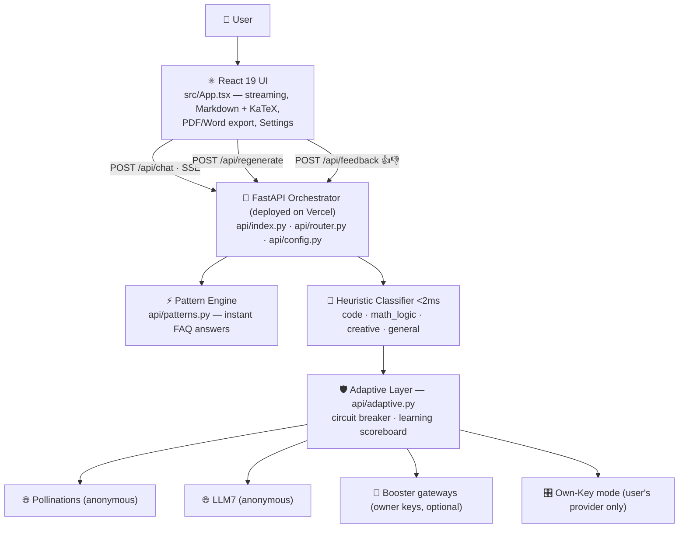

<div align="center">

# 🚀 arkAI — The Orchestrated AI Chatbot

### One chatbot. Many AI brains. **Zero API key needed.**

[](https://github.com/AbdurRahmanKhan000/CodeAlpha_Cloud_AIChatbot)
[](https://github.com/AbdurRahmanKhan000/CodeAlpha_Cloud_AIChatbot)
[](https://github.com/AbdurRahmanKhan000/CodeAlpha_Cloud_AIChatbot)
[](https://github.com/AbdurRahmanKhan000/CodeAlpha_Cloud_AIChatbot)
[](https://github.com/AbdurRahmanKhan000/CodeAlpha_Cloud_AIChatbot)
[](https://github.com/AbdurRahmanKhan000/CodeAlpha_Cloud_AIChatbot)

**arkAI is not tied to any single AI company.** Every question is classified locally in **under 2 milliseconds**, then dispatched to the **best available free AI model** for that kind of question. If a model is busy, arkAI cascades to the next one — and it **learns** from anonymous feedback which models actually deserve your questions.

[✨ Features](#-features) · [🧠 Model Pool](#-the-free-model-pool) · [🏗️ Architecture](#️-architecture) · [⚙️ Backend](#️-backend-features) · [🔌 API](#-api-reference) · [🚀 Run Locally](#-run-locally)

</div>

---

## ✨ Features

| | Feature | How it works |
| :--- | :--- | :--- |
| 🆓 | **No API key, no cost, no setup** | Default mode runs on free anonymous gateways — **Pollinations** and **LLM7**. Not Gemini-locked, not OpenRouter-locked, not any single vendor. |
| 🧭 | **Best model per question** | A sub-2ms heuristic router classifies every prompt (**code / math & logic / creative / general**) and ranks the model pool per intent. Code goes to DeepSeek & Codestral, creative work to GLM & Mistral, reasoning to GPT-OSS & Nemotron. |
| ⚡ | **Instant local answers** | A built-in **pattern engine** answers arkAI's own FAQs (pricing, hours, services, refunds, SLA, security, API limits…) in **microseconds** — no network call at all. |
| 🔄 | **Regenerate = a different brain** | Every reply has **Regenerate**: the same question is re-asked on the **next best model that hasn't answered it yet**. Repeated clicks keep hopping — never a repeat — and your previous answer is **kept** if every other model is momentarily busy. |
| 📥 | **Download any reply** | Export any answer as a beautifully designed **PDF** or **Word (.docx)** — arkAI logo on **every page**, real tables, clean math, question + model + page numbers included. |
| 🏷️ | **Model always shown** | Every answer ends with the exact model and gateway that produced it. No mystery meat. |
| 🎛️ | **Two clean modes in Settings** | **arkAI Models** (free & orchestrated) *or* **Your Own API Key** — paste a key and arkAI uses **only that provider's** models (OpenAI, OpenRouter, DeepSeek, Grok, Groq/Meta, Qwen, Gemini, Claude — auto-detected from the key). |
| 📡 | **True token streaming** | Answers stream in token-by-token like professional chatbots, with a **Stop** button, smart auto-scroll, and clean rendering: **real tables, KaTeX maths, code blocks with copy buttons**. |
| 🧠 | **It learns (privately)** | 👍/👎 and Regenerate clicks feed an **anonymous aggregate scoreboard** on the server — counters only, *never* your questions or answers — and the router re-ranks models by what's actually winning. Nothing is stored on your device. |

---

## 🧠 The Free Model Pool

Seven logical models, five AI families, two anonymous gateways — plus optional owner "booster" keys that add dedicated-quota routes invisible to end users.

| # | Logical model | Family | Gateway | Best at |
| :-: | :--- | :--- | :--- | :--- |
| 1 | **GPT-OSS 20B** | OpenAI (open weights) | Pollinations | Reasoning, general, maths |
| 2 | **DeepSeek V4 Flash** | DeepSeek | LLM7 | Code, deep reasoning |
| 3 | **GLM 5.3 Flash** | Z.ai (GLM) | LLM7 | General, creative, speed |
| 4 | **GPT-OSS 20B (LLM7 route)** | OpenAI (open weights) | LLM7 | A genuinely different route for Regenerate |
| 5 | **Codestral** | Mistral AI | LLM7 | Code specialist |
| 6 | **Mistral Nemo** | Mistral AI | LLM7 | Creative writing, everyday questions |
| 7 | **Nemotron 3 Nano 30B** | NVIDIA | LLM7 | Fast reasoning, logic, analysis |

> 🔑 **Booster house keys (optional, owner-only):** if the site owner sets `ARKAI_GROQ_API_KEY`, `ARKAI_LLM7_API_KEY`, or `ARKAI_OPENROUTER_API_KEY` as server environment variables, arkAI silently gains extra models on those dedicated quotas (e.g. Llama 3.3 70B on Groq, the OpenRouter free-model router, Nemotron 3 Super 120B). End users still need **nothing**.

---

## 🏗️ Architecture



> The entire orchestration logic exists **twice, in sync**: Python (`api/`) — what Vercel deploys — and TypeScript (`server.ts` + `src/orchestrator.ts`) for local development. Same rankings, same cascade, same behaviour.

---

## ⚙️ Backend Features

The invisible engineering that keeps arkAI fast and dependable:

| Feature | What it does |
| :--- | :--- |
| **Cascade failover** | Models are tried best-first; any failure (429 quota, 503, timeout, empty stream) moves instantly to the next model. The conversation never drops. |
| **First-token deadline (7s)** | A model that can't produce its *first token* within **7 seconds** is abandoned and the cascade moves on. This eliminated the 30–60s stalls caused by waiting out full gateway timeouts. Once tokens flow, a 30s idle gap is tolerated. |
| **Circuit breaker** | A model that fails **3 times in a row** is benched for **3 minutes** (per server instance), so requests stop wasting time on a dead quota. A single success restores it. |
| **Retry-after patience** | When a gateway replies *"retry after N seconds"*, arkAI waits and retries — but **only when that model is the last one left**, capped at 12s, and the UI shows a *"Free models are busy — retrying…"* notice so it never looks stuck. |
| **Learning scoreboard** | Anonymous counters per *(intent, model)*: thumbs up/down + regenerate-away events. Laplace-smoothed win-rates gently re-rank the router (max ~1 position shift) — arkAI routes smarter the more it's used. Counters live in server memory and **auto-persist** to Upstash/Vercel KV when `UPSTASH_REDIS_REST_URL/TOKEN` or `KV_REST_API_URL/TOKEN` are set. **No prompts, answers, or user data are ever stored.** |
| **Pattern engine** | `data/patterns.json` (9 intents, 80+ triggers) with exact → regex → fuzzy matching. Powers instant answers *and* `/api/match` + `/api/patterns`. Regenerate deliberately skips it so you always get a real AI model on re-ask. |
| **Dual-mirrored backends** | Python FastAPI (production) + TypeScript Express (local) implement identical logic; a shared test suite keeps them honest. |
| **Zero server keys by default** | The free pool needs no credentials at all. User-supplied own-keys are used only for that request's provider and are never stored server-side. |

Every chat response also carries full telemetry: `model_used`, `model_name`, `gateway_name`, `routing_time_ms`, `total_latency_ms`, `failover_history`, `next_model`, and `tried_models`.

---

## 🔌 API Reference

| Method & path | Purpose |
| :--- | :--- |
| `POST /api/chat` | Chat (JSON, or **SSE streaming** with `"stream": true`: `routing → meta → delta* → done`) |
| `POST /api/regenerate` | Same prompt on the next untried model (`current_model`, `tried_models[]`) |
| `POST /api/feedback` | Anonymous learning signal: `{ model_used, event: "up" \| "down" \| "regen", intent }` |
| `GET /api/learning` | Learning scoreboard + circuit-breaker snapshot |
| `GET /api/health` | Status, version, model count, patterns indexed, learning state |
| `GET /api/models` | Full model catalog (free pool + active boosters) |
| `POST /api/route-preview` | See which model a prompt would be routed to, and the routing time |
| `POST /api/match` · `GET /api/patterns` | Pattern-engine lookup and intent catalogue |

---

## 🖥️ Frontend Highlights

- **Streaming UI** with Stop button, per-message status notices, and smart auto-scroll (never yanks you away from what you're reading)
- **Professional rendering** — one consistent font, GFM tables, KaTeX equations, code blocks with copy buttons; partial Markdown is healed live while streaming
- **Branded exports** — PDF (jsPDF) & Word (docx) with the arkAI logo on every page, real table grids, and maths converted to clean text (never garbled glyphs)
- **Thoughtful UX guards** — *"Are you sure?"* confirmations before deleting a chat or clearing all, full-screen Settings with **✕ / Back to Chat**, hover message actions, rename via the sidebar **⋯** menu
- **Dark & light themes**, multiple conversations, follow-up suggestion chips

---

## 🚀 Run Locally

```bash
# Frontend + TypeScript backend (port 3000)
bun install        # or: npm install --legacy-peer-deps
bun run dev        # or: npx tsx server.ts

# Python backend (same API, port 8000)
pip install -r requirements.txt
uvicorn api.index:app --port 8000
```

No environment variables are required for the default free mode.

## ✅ Testing

```bash
npx tsx tests/run_all_tests.ts     # 66 checks: routing, patterns, failover,
                                   # adaptive learning, latency discipline,
                                   # exports, themes + the Python suites
python3 -m unittest discover tests # 32 Python tests (router, audit, v5, latency)
bun run build                      # production build must stay green
```

## ☁️ Deployment

Deployed on **Vercel** as two services from `vercel.json`: the Vite app at the root and the FastAPI service from `CodeAlpha_AIChatbot/`. Optional environment variables: `ARKAI_GROQ_API_KEY`, `ARKAI_LLM7_API_KEY`, `ARKAI_OPENROUTER_API_KEY` (booster quotas) and `UPSTASH_REDIS_REST_URL/TOKEN` or `KV_REST_API_URL/TOKEN` (learning persistence).

---

<div align="center">

**arkAI** · ARK Ecosystem · CodeAlpha_Cloud_AIChatbot · **License: MIT**
*Many models. One conversation. No keys, no lock-in, no dead ends.*

</div>
